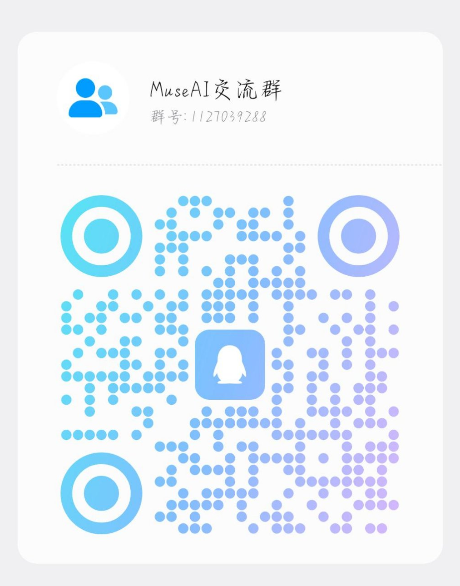

# YuSkill


YuSkill 情感实战工具箱：一套内部一致的诊断方法论。先接住情绪，再诊断局面，最后给能执行的行动。不灌鸡汤，不玩操控。

## 快速开始

### 通过 npx 安装（推荐）

```bash
npx -y skills add juliasadler/YuSkill -g --all
```

安装后回到 Agent，输入 `/yuskill` 即可开始。

### Claude Code 插件市场

```bash
claude plugin marketplace add juliasadler/YuSkill
claude plugin install yuskill@yuskill-marketplace
```

### 手动安装

把本仓库 clone 到 skills 目录：

```bash
git clone https://github.com/juliasadler/YuSkill.git ~/workspace/skills/yuskill
```

触发方式：`/yuskill`、「帮我看看」「我该怎么办」「下一步怎么走」「这句怎么回」

## 目录结构

```
YuSkill/
├── .claude-plugin/
│   ├── plugin.json               # Claude Code 插件清单
│   └── marketplace.json          # Claude Code 插件市场目录
├── skills/
│   └── yuskill/
│       ├── SKILL.md              # 主入口：三步工作流（接住情绪→诊断路由→给行动）
│       ├── 规则/
│       │   ├── 方法论总纲.md      # 十条底层逻辑，看懂权力但不玩弄权力
│       │   └── 伦理边界.md        # 禁止清单：什么技巧再有效也不用
│       ├── 诊断/                  # 7 大诊断模块，按关系进程路由
│       │   ├── 认知与吸引力.md
│       │   ├── 展示面.md
│       │   ├── 搭讪与开场.md
│       │   ├── 聊天.md
│       │   ├── 约会.md
│       │   ├── 关系.md
│       │   └── 学习方法.md
│       ├── 工具/
│       │   ├── 实战话术库.md      # 六场景话术，每条标注适用信号灯
│       │   └── 信号速查.md        # 红绿灯信号列表+投入度指标，一句话决策表
│       ├── 档案/
│       │   └── 关系档案系统.md    # 对象档案：同意机制+活跃度管理+与诊断联动
│       └── 原子库/
│           └── atoms.jsonl        # 1205 条知识原子（YS_0001 起编号）
├── README.md
├── LICENSE
└── assets/
    └── qq-group.png
```

## 核心方法论（三句话）

1. **看懂权力，但不玩弄权力**：能判断关系中的位置和动态，但不用操控手段去改变它
2. **分阶段行动**：信号不明时稳住框架；对方有明确好感或暧昧氛围后，真诚表达欣赏
3. **伦理是底线**：任何技巧不得越过 `规则/伦理边界.md`，越线的方法再有效也不用

## 使用说明

每次使用遵循三步：

1. **接住情绪**（2-4 句）：先处理人，再处理事。情绪没落地，诊断进不了脑子
2. **诊断局面**：先确认关系阶段（刚认识 / 暧昧中 / 已确定关系），再路由到对应模块。不擅自假设
3. **给行动**：诊断结论必须落到一个现在能做的小动作，附上观察窗口（做什么、看什么信号、什么时候回来反馈）

## 参与贡献

欢迎提交 Issue 和 PR。贡献前请确认：

- 内容原创，不复制其他来源的大段文本
- 遵循 `规则/伦理边界.md`，不提交操控类技巧
- 术语与现有模块一致（红绿灯、稳框架、真诚表达、分阶段）

## 交流群



*QQ 交流群：1127039288 — 更多实战交流，搜索群号加入。*

## License

MIT

---

觉得有用？点个 ⭐ Star 支持一下，谢谢！